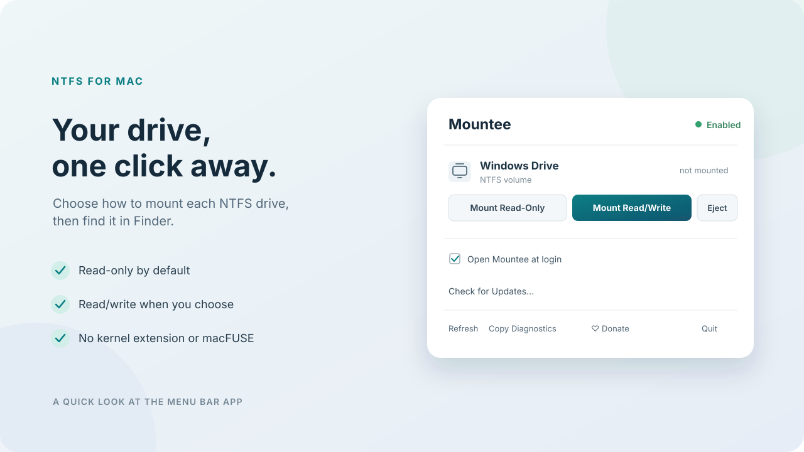

# Mountee

**Read and write NTFS drives on your Mac.**

Plug in a Windows-formatted drive, choose **Read-Only** or **Read/Write** from
the menu bar, and open it in Finder. Mountee is free and open source, uses
Apple's FSKit, and needs no kernel extension or macFUSE.

[Download Mountee](https://github.com/alvarolorentedev/mountee/releases/latest/download/Mountee.dmg) · [mountee.app](https://mountee.app) · [View on GitHub](https://github.com/alvarolorentedev/mountee)

**macOS 26 or later · Apple Silicon · GPL-3.0**

  

## Use it in three steps

1. Download and open **Mountee.dmg**.
2. Drag **Mountee.app** to **Applications**, then launch it.
3. Click **Enable File System Extension** once for your macOS account. Plug in
   an NTFS drive, choose **Mount Read-Only** or **Mount Read/Write**, then open
   the mounted drive in Finder.

That's it. No Homebrew, separate driver install, Recovery Mode, or reboot.
Enabling the extension is per macOS account, so repeat step 3 for each account
that should use Mountee.

## Why Mountee

- **Read and write, when you choose.** Apple's built-in NTFS support is
  read-only. Mountee adds an explicit read/write option for each drive.
- **No kernel extension or macFUSE.** Mountee uses Apple's FSKit and includes
  the NTFS engine in the app.
- **Safe by default.** Drives mount read-only unless you choose read/write.
  Dirty or Windows-hibernated volumes stay read-only, even when you request
  read/write.
- **A native Mac workflow.** Drives appear in Finder and at `/Volumes`; manage
  mounting, ejecting, and revealing them from the menu bar.
- **Free and open source.** GPL-3.0, with a pinned, SHA-256-verified ntfs-3g
  build.

## Requirements

- macOS 26 or later on Apple Silicon. Read/write has been verified on macOS
  26.6.2 and 27.0.1.
- No additional software or runtime dependencies.

## Safety and limits

Mountee never formats, repairs, or erases a drive. A volume marked dirty or
left hibernated by Windows Fast Startup is mounted read-only. Mountee is still
young (0.3.3), so back up valuable drives before using read/write. Crash
consistency during power loss has not been fault-injection tested.

POSIX permissions are not mapped yet, and symlinks, hard links, extended
attributes, and resource forks are unsupported. See the [full limitations
list](docs/LIMITATIONS.md) before relying on features your workflow needs.

## Help and project

- [Troubleshooting and diagnostics](docs/DIAGNOSTICS.md)
- [Development and architecture](docs/DEVELOPMENT.md)
- [Validation details](docs/VALIDATION.md)
- [License](LICENSE) · [Third-party notices](THIRD_PARTY_NOTICES.md)

Upgrading from MacNTFS?

Quit and remove `/Applications/MacNTFS.app` before installing Mountee. Launch
the new app and enable its file system extension. Mountee copies existing
diagnostic reports and leaves active mounts in place; remove older app copies
so macOS cannot rediscover their extensions.

Uninstall Mountee

Eject mounted volumes, then turn off Mountee under **System Settings → General
→ Login Items & Extensions → File System Extensions**. Quit Mountee and remove
`/Applications/Mountee.app`. To delete saved diagnostics and other app support
data too, remove `~/Library/Application Support/Mountee` and
`~/Library/Mountee`.

## Contributing

Contributions are welcome.

You can help by:

- opening bug reports
- proposing features
- improving documentation
- testing Android and iOS builds
- submitting pull requests
- helping reproduce compatibility issues with new OpenCode releases

Read the [contributing guide](CONTRIBUTING.md), [Code of Conduct](CODE_OF_CONDUCT.md),
[security policy](SECURITY.md), and [support guide](SUPPORT.md). Browse the
[issue tracker](https://github.com/alvarolorentedev/opencode-mobile/issues) or open a PR.

## ❤️ Support Us

Mountee is free and open source.

If the project is useful to you, you can help support continued development, testing, releases, and infrastructure through:

- GitHub Sponsors
- Ko-fi
- PayPal
- Bitcoin
- Ethereum

[**Support Us →**](https://mountee.app/support/)

Made with [contrib.rocks](https://contrib.rocks).
